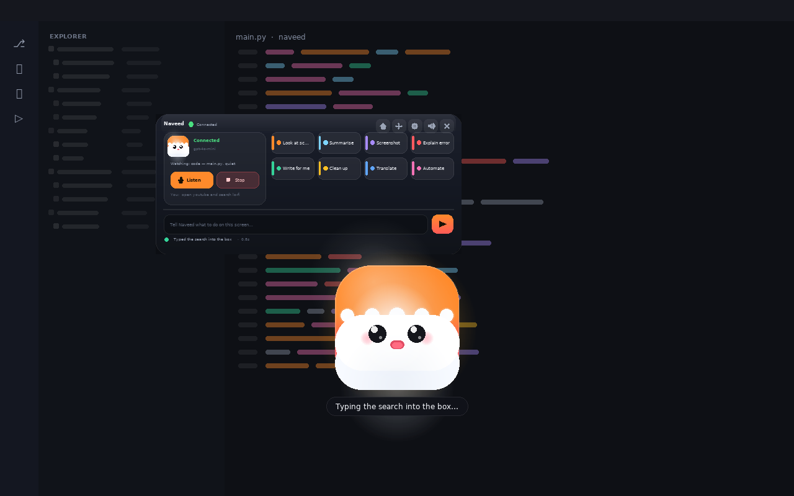
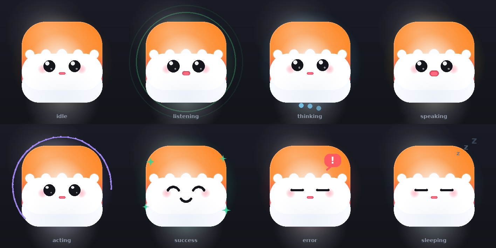

# Naveed

**A floating desktop AI companion that sits on your screen, watches what you are doing, and does the task right there.**

Not a website. Not a terminal app. Naveed is a little orange-and-white mascot that
floats above every window, period. Click it, say or type what you want, and it
looks at your actual screen, moves your actual mouse and keyboard, and tells you
what it did.

The same bot is also served to a local browser — `python -m naveed --serve`, one
page, no framework, nothing installed beyond Python — because a long instruction is
easier to type in a text box and easier to read back in a scrollback. Both front
ends drive **one** bot; see [The browser](#the-browser).

<p align="center">
  
  <br>
  <em>The mascot floats in front of whatever you are working in. The glass panel
  can sit above it, open on demand, or stay closed — click the mascot to talk.</em>
</p>

<p align="center">
  
</p>

---

## What it actually does

- **Sits on your screen and watches.** A background watcher captures the screen on
  an adaptive interval (fast while things move, slow while you read), reduces each
  frame to a signature, and keeps a bounded "world model" of what has been
  happening: which app is in front, what changed, when the screen settled.
- **Does the task on the screen.** `open youtube and search for lo-fi beats`,
  `fix the import error in this file`, `fill in this form with my details`,
  `tidy up my desktop`. A small vision model looks at the screenshot Naveed just
  took and replies with **actions** — click, type, press, scroll, open — which
  Naveed performs on your real machine.
- **Thinks with an LLM *API*, not a key.** The model is a URL and a model name —
  `LLM_API` + `LLM_MODEL`, any OpenAI-compatible endpoint, with the default being a
  local server that needs no credential at all. There is no key to find, paste or
  rotate anywhere in Naveed; if a hosted gateway insists on an `Authorization`
  header, that one optional `LLM_TOKEN` covers it.
- **Shows up in your browser too, if a text box is handier.** `python -m naveed
  --serve` puts the same bot on `http://127.0.0.1:8765` — a live log of every
  action, a status card, the quick actions, and a box for answering its questions.
  Standard library only, loopback only, no assets fetched from the internet, and it
  runs on a machine with no Qt at all.
- **Verifies its own work.** After acting, Naveed waits for the screen to settle
  and compares before/after. If nothing changed, it knows the click did nothing,
  says so, and tries a different route instead of looping forever.
- **Edits what is already there — anywhere.** Not just typing into empty fields: it
  reads a field's exact current value, changes only the part that needs changing,
  writes it back, and reads it again to confirm. It can aim at a labelled field, at
  coordinates, **or at whatever you already have the keyboard focus in** (a caret in
  a code editor, a rich-text box, a cell you just opened) without clicking anything
  at all. `append` a line to a description, `replace`
  one word in a form, leave the rest of the text — and the formatting — alone.
- **Learns a specific app from one demonstration.** Record yourself doing the task
  once (`Ctrl+Alt+T`), and Naveed distils it into a parameterised routine it can
  replay exactly, with no model in the loop. Polarion ALM ships with knowledge of
  its workflow; the routines are yours. (It does not fine-tune a model — see
  [`docs/POLARION.md`](docs/POLARION.md).)
- **Talks and listens, offline.** Click the mascot → it listens (Whisper or Vosk,
  locally) → it speaks back (Piper or your OS voice, locally). The mouth moves in
  time with its own speech.
- **Stays out of its own way.** The mascot is hidden or excluded from captures, and
  turns click-through while the agent drives your mouse — otherwise the companion
  would photograph itself and eat its own clicks. (This is a real bug class, not
  a hypothetical one: see [`docs/SCREEN_WATCHING.md`](docs/SCREEN_WATCHING.md).)
- **Refuses to do dangerous things by accident.** Passwords, 2FA codes and card
  numbers are never typed. `rm -rf /`-class commands are refused outright.
  Anything destructive gets a spoken *and* on-panel confirmation first.

> **Status.** Everything in this repo runs and is tested (317 tests,
> `python -m unittest discover tests`). The GUI itself could not be *exercised* in
> the environment it was built in — that sandbox has no display and no
> `libGL.so.1`, so Qt cannot start there at all. That is exactly why the mascot's
> geometry, the panel's layout and every icon are drawn through a canvas
> abstraction with a Pillow back-end: the art, the previews and the visual tests
> you see above are the *same code* that paints the live window. See
> [`docs/ARCHITECTURE.md`](docs/ARCHITECTURE.md#why-a-canvas-abstraction).

---

## Quick start

Naveed has **no mandatory dependencies**. The mascot, the CLI, the watcher and
the agent all import on a bare Python interpreter; each capability is unlocked by
an extra, and every heavy import happens at first use.

### 1. Install

```bash
# Linux / macOS
curl -sSL https://raw.githubusercontent.com/Naserkhan07/Naveed/main/scripts/install.sh | sh
```

```powershell
# Windows
iwr -useb https://raw.githubusercontent.com/Naserkhan07/Naveed/main/scripts/install.ps1 | iex
```

Or by hand:

```bash
pip install "naveed[ui,capture,input]"          # the companion + screen + input
pip install "naveed[full]"                      # the same, plus numpy
pip install "naveed[voice]"                     # optional offline speech (~300 MB models)
```

From a clone of this repo:

```bash
pip install -e ".[ui,capture,input]"
python -m naveed
```

### 2. Give it an LLM API

Naveed does its thinking with a small vision model behind an ordinary
OpenAI-compatible **API** — a URL and a model name. There is no key to manage: the
default is a local server that needs none, which is also the setup where nothing
leaves your machine.

```bash
python -m naveed --setup --provider ollama      # local, default, nothing leaves your PC
python -m naveed --setup --provider lmstudio    # local server with a GUI
python -m naveed --api http://127.0.0.1:8080/v1 --model my-model   # anything else
python -m naveed --setup --provider openai      # a hosted API (see --token below)
```

A hosted gateway that *insists* on an `Authorization` header gets one from an
optional `LLM_TOKEN` — it is never required, never asked for, and never needed for
a local model.

Settings land in `~/.naveed/config.env` — a plain text file, also editable from
the panel's gear icon. See [`examples/config.env.example`](examples/config.env.example).

### 3. Run it

```bash
python main.py
```

(The launcher is a thin wrapper: it finds Naveed, writes a first config when a
model is obviously available, tells you what is missing if anything is, and then
starts the app. `python -m naveed` does the same thing without the first-run
checks.)

The bot appears **centred just below your camera**, floating above whatever you
have open, and stays where you drag it. **Click it** to open the panel and tell it
what to do — if a microphone is available it also starts listening — press
`Ctrl+Alt+Space` from anywhere, or double-click for the panel alone.

### 4. Check everything

```bash
python main.py --check            # what is installed, what works, what is missing
python main.py --portrait me.png  # render the mascot sheet + panel mock, no GUI needed
```

`--check` asks the model endpoint whether it is **answering**, not merely
configured — a local server that is not running is the most common reason a task
dies, and it now says so up front:

```
llm api     qwen2.5vl:7b @ 127.0.0.1:11434  ✓ configured
            ✓ answered: 3 model(s) offered, including qwen2.5vl:7b
```

`--check` also *asks* the endpoint, so an address that nothing is listening on is
reported as exactly that (with the command that fixes it) instead of looking
configured and failing later.

---

## Using it

| Action | What happens |
|---|---|
| **Click the mascot** | Opens the panel, and starts listening when a microphone is available (otherwise the caret lands in the task box). |
| **`Ctrl+Alt+Space`** | The same thing from anywhere (configurable). |
| **Drag the mascot** | Moves it anywhere; the panel follows if it is open. |
| **Double-click it** | Opens/closes the control panel. |
| **Right-click it** | Menu: talk, panel, "what is on my screen?", screenshot, open in browser, settings, quit. |
| **Panel → Listen** | Same as clicking the mascot. |
| **Panel → Stop** | Cancels the current task immediately. |
| **Panel shortcuts** | *Look at screen, Summarise, Screenshot, Explain error, Write for me, Clean up, Translate, Automate.* |
| **Panel input box** | Type a task. When Naveed asks a question, answers here go straight back to it. |
| **Tray icon** | Everything above without the mascot being visible. |
| **A browser** | The same bot is served at `http://127.0.0.1:8765` — a text box, a scrollback, and the quick actions. See [The browser](#the-browser). |

### The browser

Naveed is a desktop overlay first, but the same bot is also served over HTTP, so
you can type to it in a browser — or from a tablet on the same network:

```bash
python -m naveed                 # mascot on screen *and* the page at :8765
python -m naveed --serve         # the page only, no window, works without PySide6
python -m naveed --serve --open-browser     # …and open it for me
python -m naveed --serve --host 0.0.0.0     # reachable from your LAN (token required)
python -m naveed --no-serve      # the mascot, without the page
```

Both front ends drive **one** bot when they run together: the page hands its task to
the same bridge the mascot uses, so a task typed in the browser makes the mascot
work, and its answers appear in both places. `--serve` on its own runs a normal
headless Naveed with the page as its window; it is the one mode that needs nothing
beyond the standard library.

The page shows the same things the panel does — the model and whether it answers,
what it can capture and control, the routines it has been taught — plus a running
log of everything it did, a box for answering its questions, the quick actions as
chips, and a *Listen* button when the browser has speech recognition. Nothing is
loaded from the internet, so it renders identically on an offline machine.

Loopback needs no token. Bind wider (`--host 0.0.0.0`) and every request needs the
token printed at startup, because an agent that can type into your window is not
something to leave open by accident; `--no-token` exists for a container port on a
network you already trust. [`docs/BROWSER.md`](docs/BROWSER.md) has the small HTTP
API (`/api/state`, `/api/task`, …) and how to script it or embed it.

### Command line

```bash
python -m naveed                          # the floating companion (normal use)
python -m naveed --serve                  # the same bot as a local web page
naveed-web                                # …the same thing, as a console script
python -m naveed -p "open notepad and type hello"   # one task, headless, prints each step
python -m naveed --watch                  # watch the screen and print the world model
python -m naveed --screenshot             # one capture, prints the path
python -m naveed --listen                 # record one voice command, print the transcript
python -m naveed --say "hello there"      # speak through the offline voice
python -m naveed --check                  # environment + capability report
python -m naveed --setup --provider ollama --voice en_US-amy-medium
python -m naveed --api http://127.0.0.1:1234/v1 --model qwen2.5-vl-7b-instruct   # any LLM API
python -m naveed --train polarion-set-status    # learn one task by demonstration
python -m naveed --portrait out.png       # render documentation/preview images
python -m naveed --dry-run -p "delete my downloads"   # plan only, touch nothing
python -m naveed --skills                 # what apps does it know something about?
python -m naveed --recipes                # what routines has it learned, and their arguments?
python -m naveed --teach release-my-item --teach-seconds 45   # learn one by demonstration
python -m naveed --run-recipe release-my-item --arg work_item_id=PROJ-1042 --dry-run
```

Guides for the parts that need more than a flag:
[`docs/EDITING.md`](docs/EDITING.md) for changing text that is already on screen,
[`docs/POLARION.md`](docs/POLARION.md) for the Polarion pack and how training by
demonstration works (and what it deliberately is not), and
[`docs/BROWSER.md`](docs/BROWSER.md) for the HTTP front end and its API.
[`CHANGELOG.md`](CHANGELOG.md) has what changed, and when.

---

## Built on four reference projects

You pointed at four repositories. Each was read in full and mined for the part it
genuinely does best; the code here is a **port with attribution in the module
docstrings**, not a rewrite from scratch and not a copy of a whole project.

| Repo | Licence | What was taken, and where it lives now |
|---|---|---|
| **[KenKaiii/brah](https://github.com/KenKaiii/brah)** ⭐ *the important one* | MIT | The **screen-capture recovery logic** and the desktop-overlay recipe. `screen-capture-fallback.js` → [`naveed/screen/capture_fallback.py`](naveed/screen/capture_fallback.py): when a capture comes back empty (0×0 / all-black), try a platform-native grabber before failing, keep a 4px tolerance when checking the captured display size, and *never blame permissions when they are actually granted*. `screenshot-retention.js` / `screenshot-list.js` → [`naveed/screen/retention.py`](naveed/screen/retention.py): bounded capture storage that never deletes the frame in use. `computer-use-actions.js` → [`naveed/control/keys.py`](naveed/control/keys.py): the key-alias table (`ENTER`→`Enter`, `CMD`→`Meta`, …) and drag-path normalisation. Its frameless/transparent/always-on-top/`skipTaskbar` window recipe → [`naveed/overlay/window.py`](naveed/overlay/window.py). |
| **[jarmen423/voice-computer-use-agent](https://github.com/jarmen423/voice-computer-use-agent)** | MIT | The **safety guard** and the **multi-monitor targeting rule**. `voiceuse/safety.py` → [`naveed/control/safety.py`](naveed/control/safety.py): inspect every action before it runs, require confirmation for destructive intent with a timeout, and keep credential fields out of the agent's reach. `vision_bridge.py::_capture_target` → [`naveed/screen/displays.py`](naveed/screen/displays.py): capture only the monitor showing the target window, tracking the monitor's origin so a click in the screenshot lands on the right pixel. Also the `find_window` / `focus_window` / `open_app` shape of [`naveed/control/os_control.py`](naveed/control/os_control.py). |
| **[Atum246/OpenDesktop](https://github.com/Atum246/OpenDesktop)** | MIT | The **"screen-as-state" watcher**. `src/screen-state/index.js` → [`naveed/screen/diff.py`](naveed/screen/diff.py) + [`naveed/screen/watch.py`](naveed/screen/watch.py) + [`naveed/screen/state.py`](naveed/screen/state.py): capture on an interval, reduce each frame to a signature, only record a state when the difference clears a threshold (`diffThreshold: 0.05` there), keep a bounded history and an element-transition graph. Naveed adds adaptive cadence, "did it settle?" and loop detection. |
| **[sb-arnav/BLADE](https://github.com/sb-arnav/BLADE)** | see repo | Feature reference only: it is a Tauri/Rust desktop agent, so nothing was ported. Its tool-forging design and its overlay/HUD split informed what Naveed keeps in the panel versus on the mascot itself. |

Full notes, including the exact original constants and what changed and why:
[`docs/SCREEN_WATCHING.md`](docs/SCREEN_WATCHING.md).

---

## How it works

```
        click the mascot                     a task arrives
               │                                   │
        ┌──────▼───────┐                   ┌───────▼────────┐
        │  VoiceLoop   │  "open youtube"   │  AgentBridge   │
        │  mic → text  │──────────────────▶│  worker thread │
        └──────────────┘                   └───────┬────────┘
                                                   │
                       ┌───────────────────────────┴──────────────────────┐
                       │                                                  │
              ┌────────▼─────────┐                              ┌─────────▼────────┐
              │  ScreenWatcher   │   frame + world model        │     Planner      │
              │ capture · diff · │─────────────────────────────▶│  small LLM sees  │
              │ world model      │                              │  the screenshot  │
              └────────┬─────────┘                              └─────────┬────────┘
                       │                                                  │ JSON actions
                       │          ┌───────────────────────────────────────▼────────┐
                       │          │  SafetyGuard  →  OsController  →  InputController│
                       │          │  confirm/refuse    coordinates     real clicks   │
                       │          └───────────────────────────────────────┬────────┘
                       │                                                  │
              ┌────────▼──────────────────────────────────────────────────▼────────┐
              │  "did the screen change?"  →  next step, retry differently, or done │
              └─────────────────────────────────────────────────────────────────────┘
```

- **Every import is lazy.** `naveed/lazy.py` is the rule the whole project
  follows: the mascot appears even if `mss`, `Pillow`, `pynput` and `pyttsx3` are
  all missing, and each of those is pulled in only inside the function that needs
  it. A missing dependency raises an error that names the feature and the exact
  `pip install` line.
- **One geometry, two renderers.** The mascot is *drawn* (see
  [`naveed/overlay/mascot.py`](naveed/overlay/mascot.py)) against a small canvas
  protocol with a Qt back-end for the live window and a Pillow back-end for
  previews, documentation and pixel tests.
- **Threads, then signals.** Workers do the blocking work; Qt signals carry the
  results back to the GUI thread. Everything is callback-based, which is why the
  entire agent loop is testable with a fake screen ([`tests/fakes.py`](tests/fakes.py)).

More detail: [`docs/ARCHITECTURE.md`](docs/ARCHITECTURE.md).

---

## Safety

Naveed operates your real computer, so this part is not an afterthought:

| Rule | Behaviour |
|---|---|
| Secrets | Typing a password, PIN, 2FA code, card number or access token is **refused**, with a spoken explanation asking you to type it yourself. Typing your *email* into a login box is fine — only secrets are blocked. |
| Unrecoverable commands | `rm -rf /`, `mkfs.*`, `dd of=/dev/sd*`, `reg delete HKLM`, fork bombs and friends are refused outright and are never confirmable. |
| Destructive intent | delete / shutdown / purchase / send / overwrite and similar words in the action or the request raise the risk level and require confirmation — spoken *and* on the panel — with a timeout that **denies** when nobody answers. |
| Shell | Off by default (`SAFETY_ALLOW_SHELL=false`), and allowlistable when on. |
| Budgets | Step limit, wall-clock limit, and a "nothing changed three times in a row → stop and ask" rule. |
| Dry run | `--dry-run` (or the panel checkbox) shows the plan and performs nothing. |

Details and the exact keyword/pattern lists: [`docs/SAFETY.md`](docs/SAFETY.md).

---

## Privacy

- Screenshots stay on your machine in `~/.naveed/screenshots`, and the folder
  prunes itself to the newest 100 captures.
- Only **one** current screenshot is sent to the model you configured, only when a
  task needs it. Nothing else about your machine is transmitted.
- Point `LLM_BASE_URL` at a local server (Ollama, LM Studio, llama.cpp) and no
  image ever leaves your computer.
- Voice is offline by default: Whisper/Vosk hear you locally, Piper speaks
  locally.

---

## Requirements

| | |
|---|---|
| Python | 3.9+ |
| OS | Windows 10/11, macOS 12+, Linux (X11; Wayland needs a portal or XWayland) |
| Screen capture | macOS: *Screen Recording* permission · Windows: none extra · Linux: X11 |
| Input control | macOS: *Accessibility* permission · Windows: none extra · Linux: X11/portal |
| Optional | A microphone for voice, `pytesseract` for OCR-based target lookup |
| The browser front end | Nothing extra: standard library only, and it runs on a machine with no Qt at all (`python -m naveed --serve`) |

## Troubleshooting

Common problems and their fixes live in
[`docs/TROUBLESHOOTING.md`](docs/TROUBLESHOOTING.md) — black screenshots,
"no input backend", a silent voice, the mascot swallowing clicks, a browser page
that lost its connection, and more. Start with:

```bash
python -m naveed --check
```

## Tests

```bash
python -m unittest discover -s tests -v      # 317 tests, no display required
```

| File | Covers |
|---|---|
| `tests/test_screen.py` | capture recovery chain, empty-frame detection, diff thresholds, monitor geometry + HiDPI, retention/pruning |
| `tests/test_control.py` | action normalisation, key aliases/hotkeys, the safety guard (secrets in a payload, credential-labelled fields, reads included), coordinate mapping, dry-run execution |
| `tests/test_agent.py` | the task loop: success, verification, no-change circuit breaker, asking, cancelling, budgets |
| `tests/test_overlay.py` | the lazy-import promise (checked in a fresh interpreter), theme geometry, animation, icons, the Qt startup order, placement/remembered position, cross-thread callbacks |
| `tests/test_launcher.py` | `main.py`: finding Naveed from any directory, the first-run hints, writing a config only when a model is reachable, passing flags through to the CLI |
| `tests/test_server.py` | the browser front end: every endpoint, the page's relative-URL rule, the event log the page polls, the token rule for a non-loopback host, port fallback, and the overlay sharing one bridge with the browser |
| `tests/test_visual.py` | pixel assertions on the generated art: palette, symmetry, expressions, transparency, previews |
| `tests/test_editing.py` | the edit engine: `apply_edit` as a pure function (every operation, anchors that repeat or are missing), the clipboard read path, focused-field editing (no click when the caret is already there), write-and-verify, honest failure on a locked field |
| `tests/test_skills.py` | knowledge packs: matching and prompt-budget injection, recipe rendering and expansion, record → distil → replay, the Polarion REST tools with the network stubbed, the `--polarion-check` probe (configured? answering? wrong token? no project?), config-file keys |

## Project layout

```
naveed/
  lazy.py            the lazy-import rule and its errors
  config.py          settings model + config.env
  app.py             the app façade (overlay / task / serve / watch / setup modes)
  server.py          the HTTP/browser front end (standard library only)
  webui.py           the page it serves: one string, no external assets
  screen/            capture, capture recovery, monitors, focus, diff, world model, watcher
  control/           keys, input backends, action vocabulary, safety guard, OS actions, OCR
  agent/             LLM client, prompts, planner, task loop, UI bridge
  overlay/           mascot geometry, theme, window, panel, tray, hotkeys, icons, Qt bridge
  speech/            audio helpers, offline STT, offline TTS, voice loop
  render/            canvas protocol + Pillow and Qt back-ends, previews
  skills/            knowledge packs, the Polarion pack, the recorder/distiller, learned routines
docs/                architecture, screen watching, actions, safety, editing, browser, Polarion, troubleshooting
main.py              the launcher (double-click this one)
scripts/             install.sh, install.ps1
tests/               the suite above
examples/            a fully commented config.env
CHANGELOG.md         what changed, version by version
```

## Credits

Naveed stands on the four projects above; each ported module carries a docstring
naming the original file and what changed. Built for Naseer.

MIT licensed — see [LICENSE](LICENSE).
